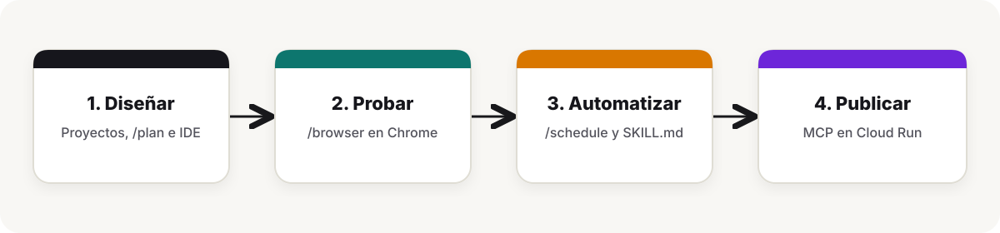

# Guía de Prompts en Vivo (Pasos 2 al 9) — GitHub Comic Heroes con Google Antigravity 2.0

**Codelab oficial:** [Getting Started with Google Antigravity](https://codelabs.developers.google.com/getting-started-google-antigravity?hl=en#0)  
**Codelab interactivo del proyecto:** [https://agy-comic-heroes.web.app](https://agy-comic-heroes.web.app)  
**App en Vivo (Cloud Run):** [https://github-comic-cards-z63pqhhmxq-uc.a.run.app](https://github-comic-cards-z63pqhhmxq-uc.a.run.app)



---

## ¿En qué paso se construye la app y cómo usar Opción A vs. Opción B?

En todos los pasos (del 2 al 9) tienes dos variantes listas para copiar:

- **Opción A (Carpeta vacía / *Fresh Folder*):** Pensada por si abres una carpeta nueva en blanco al inicio de tu charla y sigues el orden exacto del Codelab oficial. En el Codelab original, la aplicación se construye en el **Paso 7 (Artifacts con `/plan`)**; por eso en la Opción A los pasos 4, 5 y 6 funcionan sin requerir que el código exista todavía (y si prefieres construir la app antes, basta con correr el `/plan` del Paso 7 cuando muestras `/plan` en el Paso 4).
- **Opción B (Sobre esta carpeta ya creada):** Pensada por si ejecutas la demo directamente sobre este proyecto (`agy-workshop` / repositorio clonado) donde la app ya está construida, para que desde el Paso 2 hasta el Paso 9 interactúes en vivo con el código, el servidor local y la galería de cartas.

---

## Checklist: ¿Qué debes tener listo antes de salir a dar el demo?

1. **Google Chrome abierto** (y configurado como navegador predeterminado para que `/browser` en el Paso 4 conecte de inmediato).
2. **Antigravity 2.0 y Antigravity IDE instalados** en tu Mac.
3. **Credenciales de Google Cloud activas** (ya quedaron listas en tu máquina apuntando a `ai-experiments-487722`):
   - Si usas Vertex AI: `gcloud auth application-default login` y `export GOOGLE_CLOUD_PROJECT="ai-experiments-487722"`.
   - Si alguien del público prefiere usar un **API key** de AI Studio en lugar de Vertex AI: `export GEMINI_API_KEY="su-api-key"`.
4. **Archivo `~/.gemini/config/mcp_config.json` listo** (ya quedó configurado en tu Mac con `@google-cloud/cloud-run-mcp` igual al Codelab).
5. **Skill global `github-comic-heroes` instalado** (ya quedó en `~/.gemini/config/skills/github-comic-heroes/` para que incluso en una carpeta vacía genere el mismo diseño y use `gemini-nano-banana-2.1`).

---

## Paso 2 — Instalación y Verificación del Entorno
*(Sección 2 del Codelab: Installation)*

**Qué mostrar en pantalla:**
- Muestra los dos íconos en tu Dock: **Antigravity 2.0** (centro de mando de agentes) y **Antigravity IDE**.
- Comprueba que el entorno tiene Node.js y acceso a Google Cloud (sin ningún API key quemado en archivos).

### Opción A (Carpeta vacía)
```text
Verifica mi entorno local para empezar este taller desde cero: revisa las versiones instaladas de Node.js y Python, confirma qué proyecto de Google Cloud está configurado en gcloud y verifica que esta carpeta está lista para iniciar un proyecto nuevo.
```

### Opción B (Sobre esta carpeta ya creada)
```text
Verifica mi entorno local para este taller: revisa la versión de Node.js, confirma qué proyecto de Google Cloud está activo en gcloud y resume en 3 puntos los módulos que componen este repositorio de GitHub Comic Heroes (`src/`, `public/` y `.agents/skills/`).
```

---

## Paso 3 — Interfaz de Antigravity 2.0, Proyectos y Conversaciones
*(Sección 3 del Codelab: Antigravity 2.0 Interface — Projects, Conversations & Project Settings)*

**Qué mostrar en pantalla:**
1. **Proyectos y Configuración (`Project Settings`):** Haz clic en el ícono de engranaje del proyecto para mostrar que puedes agregar varias carpetas (`Add Folder`), ajustar el **Security Preset**, la política de revisión de **Artifacts** y los **MCP Servers** habilitados por proyecto.
2. **Hilos de conversación en paralelo:** Crea dos conversaciones dentro del mismo proyecto (`conv-datos-github` y `conv-idea-comic`) y renómbralas desde el menú de tres puntos.

### Opción A (Carpeta vacía)
**Conversación 1 (`conv-datos-github`):**
```text
Consulta el perfil público de GitHub y los repositorios principales del usuario "ykro" usando la API pública de GitHub. Resume en una tabla su nombre, URL de su foto de perfil (`avatar_url`), sus 3 lenguajes principales y sus 3 repositorios más destacados.
```
**Conversación 2 (`conv-idea-comic`):**
```text
A partir de un desarrollador cuyos lenguajes principales son TypeScript, Python y Kotlin y que construye agentes autónomos de IA, propón un alias de Superhéroe de Cómic, 2 superpoderes con puntaje PWR (1 a 99) y un grito de batalla para un globo de diálogo.
```

### Opción B (Sobre esta carpeta ya creada)
**Conversación 1 (`conv-datos-github`):**
```text
Revisa @src/github.js y ejecútalo o consulta la API de GitHub para el usuario "ykro". Muéstrame en una tabla qué datos reales extrae (`avatarUrl`, `topLanguages`, `topRepos`) para alimentar el generador de cartas.
```
**Conversación 2 (`conv-idea-comic`):**
```text
Lee @data/cards.json y muéstrame qué cartas de superhéroes están actualmente guardadas en el Hall of Heroes, incluyendo su alias, arquetipo, modelo de imagen usado y superpoderes.
```

---

## Paso 4 — Slash Commands (`/plan`, `/browser`, `/schedule`)
*(Sección 4 del Codelab: Slash Commands)*

**Qué mostrar en pantalla:**
- Escribe `/` en el chat para mostrar el menú de comandos (`/plan`, `/browser`, `/schedule`, `/boost`, `/teamwork`, `/grill-me`, `/learn`).
- Ejecuta `/browser` para lanzar el subagente de Google Chrome y ver cómo navega y captura evidencia visual.

### Opción A (Carpeta vacía — inspeccionando GitHub en vivo)
```text
/browser Abre https://github.com/ykro en Chrome, identifica la foto de perfil, la biografía y los repositorios principales visibles en la página, y devuélveme un resumen junto con una captura de pantalla.
```

### Opción B (Sobre esta carpeta ya creada — probando la app de Cartas Cómic)
```text
/browser Asegúrate de que el servidor (`node src/server.js`) esté corriendo en el puerto 8080. Abre http://localhost:8080 en Chrome, verifica que se muestre la carta de GitHub Comic Heroes con su retrato generado por Nano Banana 2.1, la insignia circular de la foto original de GitHub, el globo de diálogo y los superpoderes, y toma una captura de pantalla.
```

---

## Paso 5 — Scheduling Commands (`Reclutador Autónomo de Héroes`)
*(Sección 5 del Codelab: Scheduling Commands)*

**Qué mostrar en pantalla:**
- Muestra la pestaña **Schedule** en el menú izquierdo para explicar cómo programar tareas recurrentes o temporizadores únicos.
- En lugar de un recordatorio simple, programa un **Reclutador Autónomo de Héroes** a 60 segundos: mientras pasas a explicar el Paso 6, la tarea se ejecuta sola en segundo plano, toma al siguiente desarrollador famoso de la fila de retadores (`@torvalds`, `@sindresorhus`, `@gaearon`), genera su retrato en cómic con `gemini-nano-banana-2.1`, lo agrega al *Hall of Heroes* y te despierta con una notificación en vivo.

### Opción A (Carpeta vacía — Radar de Desarrollador Destacado)
```text
/schedule Programa un temporizador único dentro de 60 segundos que consulte en la API pública de GitHub el perfil de "torvalds" y sus repositorios más recientes, y me notifique con una propuesta de alias de superhéroe y nivel de poder para incluirlo como retador del día.
```

### Opción B (Sobre esta carpeta ya creada — Forjar Nuevo Retador en la Galería)
```text
/schedule Programa un temporizador único dentro de 60 segundos que ejecute `node src/cli.js --next-challenger` para forjar automáticamente la carta estilo cómic (con `gemini-nano-banana-2.1`) del siguiente retador en la fila y agregarlo a `data/cards.json`. Cuando termine, notifícame qué usuario fue reclutado, su alias de superhéroe y sus superpoderes.
```

---

## Paso 6 — Model Context Protocol (MCP) Servers y Despliegue a Cloud Run
*(Sección 6 del Codelab: Model Context Protocol (MCP) Servers)*

**Qué mostrar en pantalla:**
1. Entra a **Settings -> Customizations -> Installed MCP Servers** y haz clic en **Open MCP Config** (`~/.gemini/config/mcp_config.json`).
2. Muestra la configuración de `@google-cloud/cloud-run-mcp` y sus herramientas (`list_services`, `get_service`, `deploy_local_folder`).

### Opción A (Carpeta vacía — Consultar servicios activos en Cloud Run vía MCP)
```text
Usa el servidor MCP de Cloud Run (`list_services` y `get_service`) para listar los servicios desplegados en mi proyecto de Google Cloud (`ai-experiments-487722`) en la región `us-central1` y muéstrame la URL pública del servicio `github-comic-cards`.
```

### Opción B (Sobre esta carpeta ya creada — Desplegar la carpeta local a Cloud Run vía MCP)
```text
Usa la herramienta `deploy_local_folder` (o `get_service`) del servidor MCP de Cloud Run para desplegar o verificar este proyecto en Google Cloud Run dentro del proyecto `ai-experiments-487722` (región `us-central1`, servicio `github-comic-cards`) y devuélveme la URL pública activa.
```

---

## Paso 7 — Artifacts (`/plan`, Implementation Plan, Walkthrough y Diffs)
*(Sección 7 del Codelab: Artifacts)*

**Qué mostrar en pantalla:**
- Muestra cómo `/plan` genera primero el artifact **Implementation Plan** en el **Auxiliary Pane** (esquina superior derecha), esperando tu aprobación con **Proceed** antes de tocar el código, y al terminar produce el artifact **Walkthrough** con los diffs verificados.

### Opción A (Carpeta vacía — Construir toda la app GitHub Comic Heroes desde cero con `/plan`)
```text
/plan Diseña y construye la aplicación "GitHub Comic Heroes" en Node.js siguiendo el skill global `github-comic-heroes`:
1. `src/github.js`: consulta la API pública de GitHub (`https://api.github.com/users/<username>` y `/repos`), obtiene los lenguajes principales, top 3 repositorios y descarga la foto de perfil (`avatar_url`) en base64.
2. `src/comic-ai.js`: usa `@google/genai` con Vertex AI (`vertexai: true`, `location: "global"`) sin ningún API key en el código para transformar en paralelo la foto de perfil en una ilustración de superhéroe de cómic americano con `gemini-nano-banana-2.1` (`responseModalities: ["IMAGE"]`, `aspectRatio: "3:4"`) y generar con `gemini-3.8-flash` el alias de héroe, 2 superpoderes con puntaje PWR basados en sus repositorios y un grito de batalla.
3. `src/cli.js` (con soporte para `<username>` y `--next-challenger`), `src/server.js` y `public/index.html`: interfaz web estilo cómic en el puerto 8080 con trama halftone, insignia circular de la foto original junto al retrato ilustrado y galería Hall of Heroes.
4. Incluye el skill del proyecto `.agents/skills/comic-director/SKILL.md` y su script `.agents/skills/comic-director/scripts/hero_ranker.mjs`. No uses diagramas Mermaid en el plan.
```

### Opción B (Sobre esta carpeta ya creada — Agregar Modo Duelo de Superhéroes con `/plan`)
```text
/plan Agrega una función de "Modo Duelo (VS Battle)" en `src/server.js` (`GET /api/battle?hero1=ykro&hero2=torvalds`) y un botón en `public/index.html` que compare dos cartas del Hall of Heroes, sume sus puntos de poder (PWR), repositorios y estrellas, y declare un ganador con una narración estilo cómic. No uses diagramas Mermaid en el plan.
```

---

## Paso 8 — Antigravity IDE (`Open IDE`)
*(Sección 8 del Codelab: Antigravity IDE)*

**Qué mostrar en pantalla:**
- En el **Auxiliary Panel** (arriba a la derecha), haz clic en **Open IDE** para abrir el proyecto en **Antigravity IDE**.
- Muestra el árbol de archivos (`src/comic-ai.js`, `src/github.js`, `public/index.html`, `.agents/skills/comic-director/SKILL.md`), los diffs de código y el **Agent Panel** lateral usando menciones `@`.

### Opción A (Carpeta recién construida en el Paso 7)
```text
En @src/comic-ai.js, explícame cómo se ejecutan en paralelo `generateComicLore` (`gemini-3.8-flash`) y `generateComicPortrait` (`gemini-nano-banana-2.1`) con `Promise.all` para reducir el tiempo de generación de cada carta.
```

### Opción B (Sobre esta carpeta ya creada)
```text
Revisa @src/comic-ai.js y @src/store.js, y explícame cómo viaja la foto de perfil de GitHub en `inlineData` hacia `gemini-nano-banana-2.1` y cómo se guarda la imagen resultante en `public/generated/`.
```

---

## Paso 9 — Skills (`.agents/skills/comic-director/SKILL.md`)
*(Sección 9 del Codelab: Skills — Progressive Disclosure)*

**Qué mostrar en pantalla:**
1. Explica **Progressive Disclosure**: en lugar de saturar el contexto del agente con miles de reglas desde el inicio, Antigravity solo lee el nombre y descripción YAML de `.agents/skills/comic-director/SKILL.md` y carga sus instrucciones completas y su script `.agents/skills/comic-director/scripts/hero_ranker.mjs` únicamente cuando pides enriquecer una carta o generar su insignia coleccionable.
2. Muestra cómo el skill transforma los datos crudos de la carta en un **Dossier Oficial de Cómic** (asignándole su **Rango `OMEGA CLASS`**, su **Archienemigo técnico** y su **Historia de Origen**) y exporta un archivo SVG (`public/badges/ykro.svg`) listo para incrustar en el `README.md` de GitHub.

### Opción A (Si aún no existe la carpeta `.agents/skills/comic-director`)
```text
Crea un skill de proyecto en `.agents/skills/comic-director/SKILL.md` (junto con su script en `scripts/hero_ranker.mjs`) que tome cualquier héroe de `data/cards.json`, calcule su rango oficial (`OMEGA CLASS`, `ALPHA CLASS`), le asigne un archienemigo según su lenguaje principal, redacte su historia de origen estilo cómic clásico y exporte una insignia SVG coleccionable en `public/badges/<username>.svg`. Luego aplícalo sobre la carta de @ykro.
```

### Opción B (Sobre esta carpeta donde `.agents/skills/comic-director` ya está listo)
```text
Usa el skill comic-director para enriquecer el dossier de la carta de "ykro" en @data/cards.json (calculando su rango oficial, su archienemigo técnico y redactando una historia de origen épica basada en sus repositorios reales) y genera su insignia coleccionable SVG en `public/badges/ykro.svg`.
```
