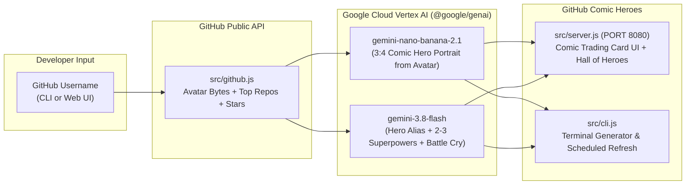

# GitHub Comic Heroes — Google Antigravity 2.0 Workshop

A hands-on project built to demonstrate every step (Steps 2 through 9) of the official [**Getting Started with Google Antigravity**](https://codelabs.developers.google.com/getting-started-google-antigravity?hl=en#0) codelab.

Enter any GitHub username to fetch their real profile photo and top repositories from the GitHub API, transform their avatar into an American comic book superhero illustration using **`gemini-nano-banana-2.1`** on Vertex AI, and generate a collectible Comic Book Trading Card with 2–3 signature superpowers and a comic speech bubble.

---

## Live Links

- **Interactive Workshop Codelab (Firebase Hosting):** [https://agy-comic-heroes.web.app](https://agy-comic-heroes.web.app)
- **Step-by-Step Prompts (Steps 2 to 9):** [`PROMPTS.md`](./PROMPTS.md)
- **Sample Skill (`.agents/skills/code-review`):** [`.agents/skills/code-review/SKILL.md`](./.agents/skills/code-review/SKILL.md)

---

## Architecture



---

## Quick Start

### 1. Clone & Install

```bash
git clone https://github.com/ykro/agy-comic-heroes.git
cd agy-comic-heroes
npm install
```

### 2. Configure Credentials (No Hardcoded Keys)

You can run the project using **Google Cloud Vertex AI** (Application Default Credentials) or a **Gemini API Key**:

```bash
# Option A: Vertex AI with Application Default Credentials (Recommended)
export GOOGLE_CLOUD_PROJECT="your-gcp-project-id"
gcloud auth application-default login

# Option B: Gemini API Key
export GEMINI_API_KEY="your-gemini-api-key"
```

### 3. Run the Web UI or CLI

```bash
# Start the Comic Card Web Studio at http://localhost:8080
npm start

# Generate a Comic Card directly from the terminal
node src/cli.js ykro

# Refresh the Featured Hero card (used in Step 5: /schedule)
node src/cli.js --refresh-featured
```

---

## Workshop Steps Covered (Steps 2 to 9)

All copy-paste prompts for the live workshop are in [**`PROMPTS.md`**](./PROMPTS.md) and in the interactive guide at [**https://agy-comic-heroes.web.app**](https://agy-comic-heroes.web.app):

1. **Step 2 — Installation & Environment Setup:** Verifying Antigravity 2.0, Antigravity IDE, and Google Cloud credentials.
2. **Step 3 — Antigravity 2.0 Interface:** Projects, multi-folder context, Project Settings, and parallel conversation threads.
3. **Step 4 — Slash Commands (`/browser`):** Spawning the Chrome sub-agent to visually inspect and screenshot the Comic Card UI.
4. **Step 5 — Scheduling Commands (`/schedule`):** Automating background refreshes of the Featured Hero card.
5. **Step 6 — MCP Servers (`cloudrun`):** Deploying the service to Google Cloud Run via the Cloud Run MCP server.
6. **Step 7 — Artifacts (`/plan`):** Generating the Implementation Plan (with Mermaid diagrams) and Walkthrough artifacts.
7. **Step 8 — Antigravity IDE:** Inspecting code diffs and using `@` file mentions in the IDE Agent Panel.
8. **Step 9 — Skills (`.agents/skills/code-review`):** Auditing and fixing `demo_bad_code.py` via progressive disclosure.
