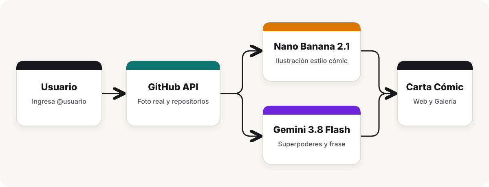

# GitHub Comic Heroes con Google Antigravity 2.0

Todo el código está disponible en este [repo](https://github.com/ykro/agy-comic-heroes), aquí está el [codelab interactivo](https://agy-comic-heroes.web.app) en [Firebase Hosting](https://firebase.google.com/docs/hosting), la [app en vivo](https://github-comic-cards-z63pqhhmxq-uc.a.run.app) en [Cloud Run](https://cloud.google.com/run/docs) y los [prompts del taller](./PROMPTS.md) para seguir los pasos 2 al 9 del [codelab oficial](https://codelabs.developers.google.com/getting-started-google-antigravity?hl=en#0) de Google Antigravity.

## Qué se construye

La aplicación recibe cualquier usuario de GitHub, descarga su foto de perfil y sus repositorios principales desde el API de GitHub y genera una carta coleccionable estilo cómic americano usando [Vertex AI](https://cloud.google.com/vertex-ai/docs). El retrato ilustrado se genera a partir del avatar real con `gemini-nano-banana-2.1` y, en paralelo, `gemini-3.8-flash` redacta su alias, sus superpoderes, sus enemigos y su frase de batalla.




Tanto en el [codelab interactivo](https://agy-comic-heroes.web.app) como en `PROMPTS.md`, cada paso del taller incluye dos opciones. La **Opción A** parte de una carpeta vacía y construye la aplicación en el Paso 7 con `/plan`, mientras que la **Opción B** trabaja directamente sobre este repositorio para probar el servidor local, los *time-based loops* con `/schedule` (para revisar un PR, ver comentarios de un *reviewer*, vigilar un CI que falla o agregar un nuevo enemigo a la galería), el deploy por MCP a Cloud Run y el skill `.agents/skills/comic-director/SKILL.md`.

## Cómo correrlo en local

Clona el repositorio e instala las dependencias con `npm install`.

```bash
git clone https://github.com/ykro/agy-comic-heroes.git
cd agy-comic-heroes
npm install
```

Para autenticar el acceso a los modelos de Gemini sin uso de key en el código, puedes usar Application Default Credentials de Google Cloud o definir un API key en tu sesión de terminal.

```bash
# Con Vertex AI (ADC)
export GOOGLE_CLOUD_PROJECT="tu-proyecto-de-gcp"
gcloud auth application-default login

# Opcional si prefieres usar un API key
export GEMINI_API_KEY="tu-api-key"
```

Con las credenciales listas puedes levantar el servidor web o usar el CLI.

```bash
# Iniciar la aplicación web en http://localhost:8080
npm start

# Generar una carta desde la terminal
node src/cli.js ykro

# Generar la carta del siguiente enemigo desde CLI
node src/cli.js --next-enemy

# Actualizar rango, enemigo principal e insignia SVG con el skill del proyecto
node .agents/skills/comic-director/scripts/hero_ranker.mjs ykro

# Restaurar estado inicial de las cartas de demostración
npm run demo:reset
```

## Conclusiones

La idea de este proyecto es tener un ejemplo práctico y visual para recorrer las herramientas de Antigravity 2.0 en una sesión en vivo, combinando llamadas al API de GitHub, generación de imagen y texto en Vertex AI, automatización asíncrona y publicación en Cloud Run. **Nos vemos en el código.**
